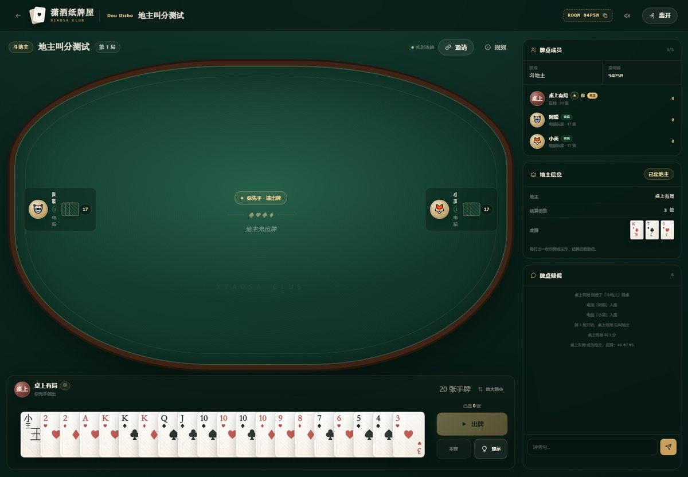
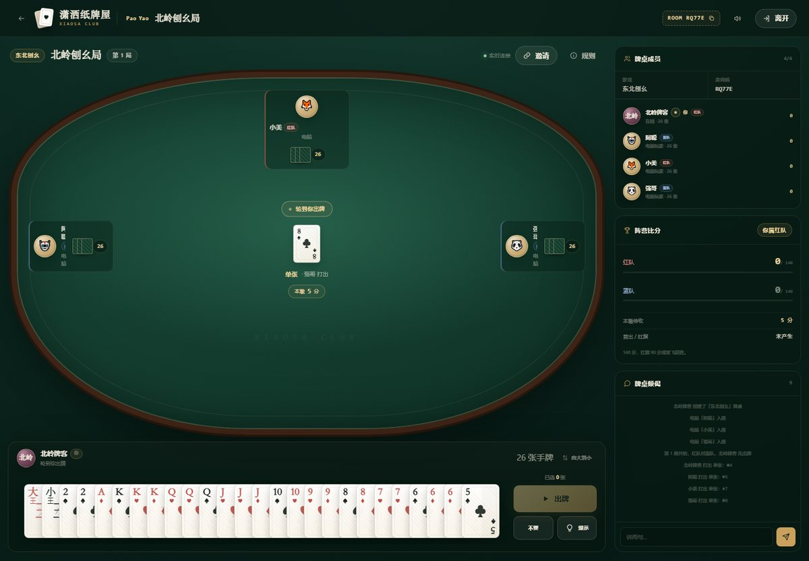
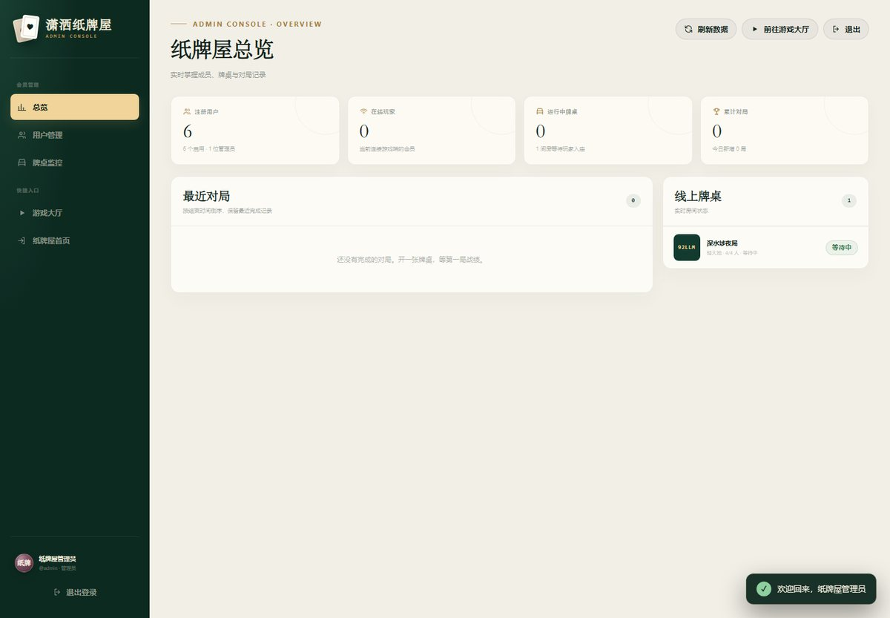

# 潇洒纸牌屋 · Xiaosa Club

一个可直接运行的 Web 纸牌游戏平台：**玩家游戏端** + **管理员后台** 双入口，支持创建房间、实时对战、房间内切换玩法，以及房主补入电脑玩家。

内置三款玩法：

| 游戏 | 人数 | 说明 |
| --- | --- | --- |
| **锄大地** | 2–4 人 | 广东 / 香港经典 Big Two，方块 3 先手 |
| **斗地主** | 3 人 | 叫地主、抢底牌、炸弹翻倍，地主对两农 |
| **东北刨幺** | 4 人 | 两副牌 108 张，对家一队，路 / 幺 / 王炸与抓分 |








## 功能

- **双入口**
  - 玩家入口：登录、游戏大厅、创建 / 加入房间、实时牌桌、聊天、规则弹窗。
  - 管理入口：总览数据、创建用户、编辑昵称 / 角色 / 状态、重置密码、停用、删除、牌桌监控、对局记录。
- **房间系统**
  - 5 位房间码、邀请链接、房主转让、准备 / 开局、移出玩家、聊天。
  - 创建房间时选择玩法；斗地主固定 3 人，刨幺固定 4 人，锄大地支持 2 / 3 / 4 人。
  - 房主可在开局前切换游戏类型，房间人数上限会按新玩法自动适配。
  - 房主可一键补满电脑玩家，单人也能完整开局。
- **实时与可靠性**
  - 原生 `EventSource` / Server-Sent Events 推送大厅、牌桌、出牌、叫分、聊天和结算。
  - 服务端权威判定，刷新页面后可重新进入房间继续。
  - 登录会话、`scrypt` 密码哈希、管理员接口鉴权、XSS 转义、CSP 响应头。
- **零依赖**
  - 不需要 `npm install`，使用 Node 内置 `http`、`crypto`、`node:sqlite`。
  - 前端为原生 JS / CSS 单页应用，无构建步骤。

## 快速开始

要求 **Node.js ≥ 22.13**（推荐 Node 24；`node:sqlite` 无需额外安装）。

```bash
# 在项目根目录
node server/index.js
```

Windows 也可以双击 `start.bat`。

打开：

- 游戏入口：<http://localhost:3000>
- 管理后台：<http://localhost:3000/#/login/admin>

**默认管理员**

```text
账号：admin
密码：admin123
```

> 首次进入后台后，请在「用户管理 → 编辑」中修改默认密码。

## 五分钟上手

1. 用 `admin / admin123` 进入管理后台。
2. 在「用户管理 → 创建用户」里开通玩家账号。
3. 从玩家入口登录，点击「创建牌桌」，选择玩法：
   - 锄大地：2–4 人；
   - 斗地主：3 人；
   - 东北刨幺：4 人。
4. 在等待房点击「补满电脑」→「准备」→「开始牌局」。
5. 斗地主先完成叫地主；其余玩法直接进入牌桌。
6. 点选手牌，或先点「提示」自动选牌，再点「出牌」。先出完手牌 / 达成胜利条件者胜。

## 三款玩法

### 锄大地（Big Two）

- 2 人各 26 张、3 人 18/17/17 张、4 人各 13 张。
- 点数 `2 > A > K > Q > J > 10 … > 3`，同点数比花色：黑桃 > 红桃 > 梅花 > 方块。
- 方块 3 先手，首轮必须带出方块 3。
- 单张、对子、三条，五张牌型 `顺子 < 同花 < 葫芦 < 四条 < 同花顺`，可跨类型压制。
- 支持 `A-2-3-4-5`、`2-3-4-5-6` 两种小顺；`J-Q-K-A-2` 不算顺子。
- 赢家获得所有失分之和；剩牌 1–9 每张 1 分、达到起始手牌 75% 每张 2 分、未出过牌每张 3 分。

### 斗地主（Dou Dizhu）

- 3 人，一副 54 张牌（含大小王），每人 17 张 + 3 张底牌。
- 叫地主：轮流叫 `1 / 2 / 3 分` 或「不叫」，每人一轮，最高分成为地主；叫 3 分立即成为地主；全部不叫重新发牌。
- 地主获得 3 张底牌并先出。
- 支持单张、对子、三条、三带一、三带二、顺子、连对、飞机、飞机带单 / 带对、四带二、四带两对、炸弹、王炸。
- 普通牌型需同类型、同张数比较；炸弹压普通牌，王炸最大。
- 底分为最高叫分，每打出一次炸弹或王炸倍数翻倍。
- 地主胜：地主 `+2 × 底分 × 倍数`，两农民各扣一份；农民胜则相反。任一农民先出完即农民方胜。

### 东北刨幺（Pao Yao）

- 4 人，两副牌共 108 张，每人 27 张；对角座位为同一队（红队 / 蓝队）。
- 单张牌力：`大王 > 小王 > 3 > 2 > A > K > Q > J > 10 … > 4`。
- 牌型：单张、对子、单龙（3 张以上连续单牌）、双龙（3 对以上连续对牌）、3–8 路、幺牌、王炸组合。
- 双龙可以「骑」同张数的单龙；3 和 2 不能进入顺子。
- 幺牌：`44A` 小幺、`444A` 中幺、`4444A` 老幺、5 张以上 4 + A 老老幺。
- 王炸组合包含双小王、大小王、大王对、两小王 + 大王、两大王 + 小王、四张王。
- 5 算 5 分，10 和 K 各 10 分，两副牌共 200 分；一墩牌由收下的一方获得本墩所有分数。
- 获胜：一队达到 140 分；或先出完牌的一方（扛旗）且队伍达到 90 分；一队两人都先出完则「双飞」；200 分按 4 倍结算。
- 接风：一家出完后若最后一手无人压住，由对家领出。
- **本馆简化**：暂不启用「雪牌」追加阶段，达到胜利条件即结束，按 1 倍结算（200 分按 4 倍）。「不要」后本轮不再出牌，直到本轮结束。

## 配置

```bash
PORT=8080 HOST=0.0.0.0 DATA_DIR=./data BOT_DELAY_MS=850 node server/index.js
```

| 变量 | 默认值 | 说明 |
| --- | --- | --- |
| `PORT` | `3000` | HTTP 端口 |
| `HOST` | `0.0.0.0` | 监听地址 |
| `DATA_DIR` | `./data` | SQLite 数据目录 |
| `BOT_DELAY_MS` | `850` | 电脑玩家思考间隔（毫秒，范围 80–3000） |

数据库文件：`data/game.db`（WAL 模式）。重置所有用户和战绩：停止服务后删除 `data/`，重新启动会生成默认管理员。

## 项目结构

```text
.
├─ server/
│  ├─ index.js            # HTTP 服务、REST API、SSE、静态资源
│  ├─ games.js            # 游戏注册表 + 引擎适配器 + 各玩法规则文案
│  ├─ db.js               # SQLite 初始化、用户 / 会话 / 战绩
│  ├─ rooms.js            # 房间状态机、房主权限、电脑玩家调度
│  └─ game/
│     ├─ bigTwo.js        # 锄大地规则引擎
│     ├─ douDizhu.js      # 斗地主规则引擎
│     ├─ paoYao.js        # 东北刨幺规则引擎
│     └─ cards54.js       # 54 / 108 张牌堆、洗牌、公共牌结构
├─ public/
│  ├─ index.html
│  ├─ styles.css
│  ├─ app.js              # 原生 SPA：路由、双入口、大厅、牌桌、后台
│  └─ favicon.svg
├─ tests/
│  ├─ run-all.mjs         # 全部规则单测入口
│  ├─ bigTwo.test.js
│  ├─ moreGames.test.js
│  ├─ smoke.mjs           # 锄大地端到端烟测
│  ├─ allGamesSmoke.mjs   # 三款游戏端到端烟测
│  ├─ ui-check.mjs        # 可选：Chrome CDP 界面验收
│  └─ games-ui-check.mjs  # 可选：三款游戏界面验收
├─ data/                  # 运行时生成
├─ docs/                  # README 预览图
├─ start.bat
└─ package.json
```

## 测试

规则引擎单测（无需启动服务）：

```bash
node tests/run-all.mjs
# 或 npm test
```

覆盖 24 项：锄大地牌型 / 发牌 / 过牌 / 计分；斗地主叫地主、组合、炸弹、结算；刨幺牌力、顺子、双龙、路、幺、王炸、抓分、双飞。

三款游戏端到端烟测（需先启动服务）：

```bash
node tests/allGamesSmoke.mjs
```

为了更快跑完，可以这样启动测试服务：

```bash
BOT_DELAY_MS=120 node server/index.js
```

可选界面验收：先以调试端口启动本机 Chrome，再执行 `node tests/games-ui-check.mjs`，会生成 `artifacts/` 截图并检查控制台错误。

## 扩展新玩法

1. 在 `server/game/` 新增规则引擎。
2. 在 `server/games.js` 的 `GAME_REGISTRY` 注册元数据与人数范围。
3. 在 `ENGINE_ADAPTERS` 中接入 `create / play / pass / getHint / getHand / getPublic`，如玩法有叫分阶段再接入 `bid / botBid`。
4. 房间、SSE、机器人调度、管理后台、战绩系统可直接复用。
5. 前端 `room.gameType` 分支补充该玩法的专属面板与操作即可。

## 安全与部署备注

- 默认管理员密码仅用于本地首次启动，请立即修改。
- 生产部署建议放在 HTTPS 反向代理之后；SSE 已设置 `no-transform` 与心跳。
- 会话令牌保存在浏览器 `localStorage`，有效期 7 天。
- 用户密码使用 Node `crypto.scrypt` 加盐哈希存储；管理员接口均做角色校验。
- 当前房间与对局状态保存在服务端内存，重启服务会清空进行中的牌桌；用户、战绩、会话持久化在 SQLite。
